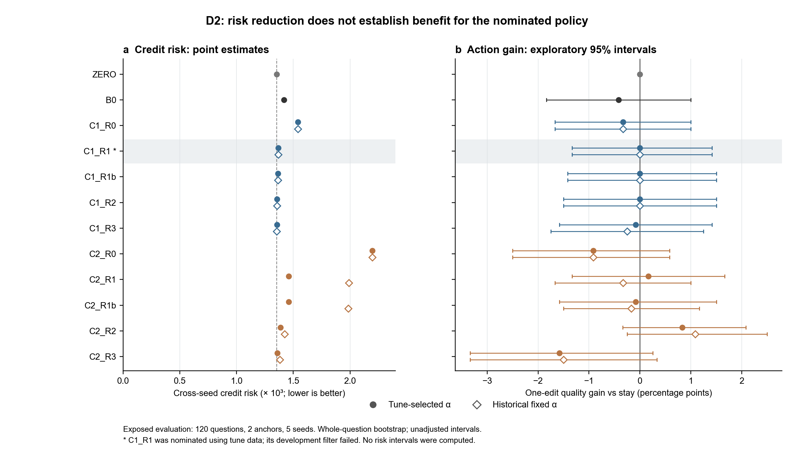

# MAB2 D2：信用预测失败的有限根因诊断

作者侧内部科研报告草稿；机器复算完成，作者人工审阅待完成。证据等级为已曝光数据上的事后开发诊断；不是期刊外审、独立确认或投稿论文。

**结论：原R0的基准质量惩罚会产生正信用分量；去掉该偏置降低风险，却未得到通过预定开发过滤的预测器。** [evidence:E01,E02]

## 1. 范围、目标与来源

本轮复用G2的200题训练、80题调参及已曝光120题评价；每题两个锚点、每锚点12条单边比较、每图5个冻结种子。共10,394个唯一题—图行及51,970条历史输出；没有新生成调用。本轮不打开最终封存测试。原始题目、答案和逐题数据不包含在本报告包内。

主要开发指标是单次切边或保持的平均质量收益：使用预测存在信用乘以切换方向，选严格为正的最大增益，否则保持；质量成本权重为0。α仍仅由tune信用均值MSE选择，固定8点网格、不重拟合。tune动作收益用于8个改动变体中至多一个的提名，随后用已曝光120题做开发过滤，失败不改选第二名。[evidence:E03]

本包的E01为D2聚合结果，E02为独立真实复算，E03为冻结协议；来源摘要及SHA256见[source_manifest.json](source_manifest.json)。独立复算使用派生数组重新构造图特征、以正规方程重拟合选定及历史固定α，重算动作、跨种子风险、bootstrap与LOSO。共914项检查，最大差4e-14。未重读原题、gold或原始服务输出；未重新拟合所有候选完整α路径。[evidence:E02]

## 2. 对照与归因

| 变体 | 训练目标中的改变 | 可以检验什么 | 解释限制 |
|---|---|---|---|
| R0 | 原始唯一图质量回归，所有系数L2惩罚 | 原目标重放与锚点 | 基准质量与掩码特征可能分摊常数响应 |
| R1 | 仅全局常数项免罚 | 全局截距惩罚的影响 | 不等于移除问题依赖基准 |
| R1b | 问题基准a0(x)的九列免罚 | 线性问题基准的影响 | 仍受表示能力限制 |
| R2 | 同题X与y同时按唯一图权重中心化 | 去除自由题内基准 | 与R3的观测零空间不同 |
| R3 | 使用同批图构造原定24条差分 | 决策方向重加权 | 共享图的差分相关；不增加独立样本数 |

所有变体分别用于C1一阶和C2二阶表示，保留ZERO与B0两个基线。两个锚点的比较图可能不连通；R2与R3不能只按“质量目标/信用目标”两个词归因。差分图秩与分量的汇总保留在证据JSON中。有效自由度针对各自准备后的观测算子，不能直接当作共同绝对图质量模型的复杂度。

## 3. 全部12方法：tune选定α

| 方法 | α | tune 收益 (pp) | exposed 收益 (pp) [95% CI] | tune 风险 ×10³ | exposed 风险 ×10³ | exposed 删/加/停 |
|---|---:|---:|---|---:|---:|---:|
| ZERO | — | 0.000 | 0.000 [0.000, 0.000] | 1.6667 | 1.3542 | 0/0/240 |
| B0 | — | -0.375 | -0.417 [-1.833, 1.000] | 1.6792 | 1.4169 | 178/62/0 |
| C1_R0 | 1000 | -0.375 | -0.333 [-1.667, 1.000] | 1.9952 | 1.5414 | 0/234/6 |
| C1_R1 | 1000 | 0.750 | 0.000 [-1.333, 1.417] | 1.6635 | 1.3671 | 226/12/2 |
| C1_R1b | 1000 | -0.125 | 0.000 [-1.417, 1.500] | 1.6599 | 1.3654 | 232/8/0 |
| C1_R2 | 1000 | 0.125 | 0.000 [-1.500, 1.500] | 1.6672 | 1.3579 | 237/0/3 |
| C1_R3 | 100 | -0.500 | -0.083 [-1.583, 1.417] | 1.6617 | 1.3557 | 178/62/0 |
| C2_R0 | 100 | -1.625 | -0.917 [-2.500, 0.583] | 2.5932 | 2.1959 | 52/188/0 |
| C2_R1 | 1000 | -0.375 | 0.167 [-1.333, 1.667] | 1.7025 | 1.4593 | 202/38/0 |
| C2_R1b | 1000 | -0.125 | -0.083 [-1.583, 1.500] | 1.6935 | 1.4593 | 210/30/0 |
| C2_R2 | 1000 | -1.000 | 0.833 [-0.335, 2.083] | 1.6721 | 1.3864 | 237/0/3 |
| C2_R3 | 1000 | -1.750 | -1.583 [-3.333, 0.250] | 1.6664 | 1.3581 | 175/65/0 |

pp为质量比例差×100，不是相对改善百分比。exposed共120题、240锚点；tune共80题、160锚点。误差区间为10,000次整题bootstrap，两个锚点共同重采样，随机种子59173，探索性且未作多重比较校正。tune收益CI和D2风险CI未计算，不能补造。风险是五种子误差的非重复跨种子乘积均值，不是朴素观测均值MSE；两者均保留在CSV中。

## 4. 全部12方法：历史固定α

| 方法 | α | tune 收益 (pp) | exposed 收益 (pp) [95% CI] | tune 风险 ×10³ | exposed 风险 ×10³ | exposed 删/加/停 |
|---|---:|---:|---|---:|---:|---:|
| ZERO | — | 0.000 | 0.000 [0.000, 0.000] | 1.6667 | 1.3542 | 0/0/240 |
| B0 | — | -0.375 | -0.417 [-1.833, 1.000] | 1.6792 | 1.4169 | 178/62/0 |
| C1_R0 | 1000 | -0.375 | -0.333 [-1.667, 1.000] | 1.9952 | 1.5414 | 0/234/6 |
| C1_R1 | 1000 | 0.750 | 0.000 [-1.333, 1.417] | 1.6635 | 1.3671 | 226/12/2 |
| C1_R1b | 1000 | -0.125 | 0.000 [-1.417, 1.500] | 1.6599 | 1.3654 | 232/8/0 |
| C1_R2 | 1000 | 0.125 | 0.000 [-1.500, 1.500] | 1.6672 | 1.3579 | 237/0/3 |
| C1_R3 | 1000 | -0.500 | -0.250 [-1.750, 1.250] | 1.6660 | 1.3542 | 178/62/0 |
| C2_R0 | 100 | -1.625 | -0.917 [-2.500, 0.583] | 2.5932 | 2.1959 | 52/188/0 |
| C2_R1 | 100 | 0.125 | -0.333 [-1.667, 1.000] | 2.1777 | 1.9906 | 161/79/0 |
| C2_R1b | 100 | -0.250 | -0.167 [-1.500, 1.167] | 2.1401 | 1.9833 | 157/83/0 |
| C2_R2 | 100 | -1.000 | 1.083 [-0.250, 2.500] | 1.7301 | 1.4226 | 213/27/0 |
| C2_R3 | 100 | -1.125 | -1.500 [-3.333, 0.333] | 1.6713 | 1.3815 | 167/73/0 |

C1固定α=1000、C2固定α=100。ZERO与B0没有α，重复出现仅便于对照，不是额外实验。全部48个方法×配置×数据角色记录见[method_metrics.csv](method_metrics.csv)，含动作支持数、非零观测符号分母、排序可定义/不可定义锚点数。其浮点原值不被改写；表格仅按显示精度舍入。

## 5. 常数响应控制及固定α证据

在图无关的常数响应控制中，原R0惩罚所有系数产生C1平均信用0.01770203、C2平均信用0.02611512，两者信用均为正。 [claim:C02] [evidence:E01,E02]

| 原模型 | 原响应信用均值 | 常数分量均值 | 常数分量为正 | 残差分量均值 |
|---|---:|---:|---:|---:|
| C1_R0 | 0.01690180 | 0.01770203 | 100.0% | -0.00080023 |
| C2_R0 | 0.02053214 | 0.02611512 | 100.0% | -0.00558298 |

控制响应固定为训练质量的题均加权均值，真实图差由构造为零。在线性ridge下，原响应预测精确分解为常数分量与残差分量。它建立了这个目标与设计矩阵下的伪信用机制，不能把非线性动作选择后的收益也作同样加法归因。

R0全系数惩罚是原冻结目标；本次发现属于原目标的统计性质，不是旧实现违反原合同。 [claim:C05] [evidence:E02,E03]

| 对照 | α | exposed 风险 ×10³ | exposed 收益 (pp) [95% CI] |
|---|---:|---:|---|
| C1_R0 / selected | 1000 | 1.541436 | -0.333 [-1.667, 1.000] |
| C1_R1 / historical_fixed | 1000 | 1.367148 | 0.000 [-1.333, 1.417] |
| C2_R0 / selected | 100 | 2.195856 | -0.917 [-2.500, 0.583] |
| C2_R1 / historical_fixed | 100 | 1.990558 | -0.333 [-1.667, 1.000] |
| C2_R1 / selected | 1000 | 1.459301 | 0.167 [-1.333, 1.667] |

保持历史α不变，免罚全局截距仍降低本批数据上的信用风险；C2再从α=100改选1000的额外变化必须与截距因素分开。 [claim:C03] [evidence:E01,E02,E03]

## 6. 提名、失败与不确定性

预定提名为C1_R1，开发过滤失败且无替补；其已曝光评价收益为0.000 pp，95%区间为[-1.333, 1.417] pp。 [claim:C01] [evidence:E01,E02]

C1_R1仍在240个锚点中编辑238次（删226、加12、保持2）。风险缩小没有转化为可靠的编辑方向或弃权能力。其他方法在exposed数据上更高的点估计不能用于改选；例如C2_R2的正点估计不推翻事先规定的单候选规则。区间跨零表示精度不足以建立该项收益，不能等同于方法确实无效或与基线等效。

图1：左侧为已曝光120题的跨种子信用风险点估计；没有风险CI。右侧为相对保持的质量收益及探索性95%整题bootstrap区间。圆点为tune选定α，空心菱形为历史固定α；ZERO/B0只绘制一次。灰色背景行表示预定提名C1_R1，非显著性标记。图只用于阶段诊断，不是正式投稿图。[evidence:E01,E02,E03]

## 7. LOSO不是未来题在线收益

| 数据角色 | 题数 | 五种子同菜单最大观测收益 (pp) | LOSO收益 (pp) [95% CI] |
|---|---:|---:|---|
| train | 200 | 11.700 | 1.500 [0.350, 2.701] |
| tune | 80 | 11.875 | 2.500 [0.000, 5.125] |
| exposed | 120 | 11.667 | 1.917 [0.333, 3.750] |

LOSO同题诊断为1.917 pp，95%区间[0.333, 3.750] pp；它未计全菜单反馈成本，不证明未来新题上的服务收益。 [claim:C04] [evidence:E01,E02,E03]

LOSO先查看同一道题四个种子下全部候选动作的反馈，再选择动作并用第五种子评分；五个fold重叠，不是五次独立实验。它可提示同题重复执行中存在部分可复用信息，不能证明只依靠历史题反馈的路由器能够泛化到下一题。原方案要求本题计划在生成和评分前冻结，反馈更新未来决策；LOSO没有执行这一在线流程。获取同题菜单的重执行和评分成本也未纳入收益。五种子全零和均值零是含噪观测分层，不能当作真实信用为零。

## 8. 成本：已知、上界与未知

| 项目 | 记录 | 解释 |
|---|---:|---|
| D2主进程CPU | 23.421875 s | 含线程CPU，从进程起点计 |
| D2墙钟 | 23.046947 s | 与CPU时间不同 |
| Git子进程CPU | 未测量；上界3.505133 s | 由命令墙钟×逻辑核数保守计入 |
| 既往D2尝试CPU上界 | 0.000000 s | 保留累计口径 |
| 独立复算主体CPU | 2.750000 s | 不含进程初始化；与D2分别记录 |
| 新生成调用 / GPU时间 | 0 / 0 | 本轮复用历史输出 |
| 历史推理、评分与其他工程支出 | 本表未重汇总 | 不能把复用数据解释为零成本获取 |
| 人工时间、代理推理、能耗、货币费用 | 未计量 | 不提供虚构完整金额或回本点 |

报告生成开销另记录在[costs.csv](costs.csv)。以上是可追溯的本轮计算账目，不是整个项目的完整成本账本，也不构成任何在线全预算优势。

## 9. 置信等级与阶段决策

| 判断 | 置信等级 | 依据/范围 |
|---|---|---|
| 数值与提名规则实现一致 | 高 | 真实派生数组独立复算及来源哈希 |
| R0常数响应产生伪信用 | 高 | 固定目标控制与线性分解 |
| 固定α免罚截距降低本批风险 | 高 | 限本批已曝光数据的点估计比较 |
| 预测器具备未来图编辑能力 | 未建立 | 提名未通过，缺少新独立确认 |
| 图驱动复检优于随机/周期/最大不确定性 | 未知 | 本轮未执行在线机制比较 |
| 泛化至其他任务/异质模型/恢复场景 | 未知 | 本轮未评价 |

优势：有限且可分解的对照定位了原目标的一项偏置；全部负结果、支持数和无替补规则保留。风险：去偏置后信号仍弱；多次接触旧120题限制任何新肯定结论；差分模型未来接入G3必须重审观测算子、信息更新与付费反馈权限。

尚无新独立确认、完整成本在线机制收益或恢复证据；本报告不构成完整论文，也不支持ACL投稿就绪声明。 [claim:C06] [evidence:E01,E02,E03]

下一步只能在既定诊断次数与计算预算内，决定是否存在值得新独立确认的合法未来题决策信号；不能因LOSO的正区间直接宣称核心机制成功，也不能不断扩大模型或阈值搜索。任何第二轮诊断须保留本轮失败结论并单独编号。

## 10. 复现与审阅边界

运行`python render_d2_report.py --evidence d2_evidence.json --out .`可重建本报告、CSV和图。它只使用脱敏汇总包；不能用它替代派生数组的独立重拟合。完整源证据通过内容哈希关联，逐题材料及机器环境位置保留在项目私有记录中。

本包由AI协助生成，使用research-rigor、scientific-writing、peer-review的证据与表达检查，以及nature-figure的Python可视化约定。这里没有声称作者人工核验、期刊政策批准或编辑录用决定。对作者侧审查的具体事项见[INTERNAL_REVIEW.md](INTERNAL_REVIEW.md)；验证范围见[validation.json](validation.json)。
