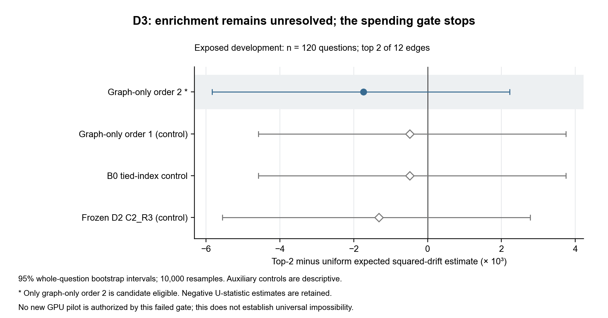

# MAB2 D3：图条件信用漂移富集的最后一轮CPU诊断

作者侧内部报告草稿；机器独立复算完成，人工作者审阅待完成。使用已曝光G2数据，不是新独立确认，也不是完整论文。

**唯一预定候选未通过算力准入门：STOP_CURRENT_CANDIDATE_ROUTE；统计分类为INCONCLUSIVE，点估计方向为负。**

## 1. 预定问题与执行范围

本轮检验不使用问题文本的共享二阶图模型，能否在另一道题的两个图背景之间识别信用变化较大的边。训练仍为200题的24个预定存在信用方向，逐题总权重1；80题用于固定8点α网格的信用MSE选择，不重拟合。旧120题只承担开发评价。所选模型含79个图特征，信用差中有效参数为78维；最终α=1000，位于既定网格上界。不得据此事后扩展网格或新增候选。

模型根据冻结系数与当前图掩码计算两锚点预测存在信用差的绝对值，固定选top-2；同题标签不进入选择。α由信用MSE确定，算力门只看漂移富集，不要求当前动作收益或全局MSE改善。两类指标的角色在协议中预先区分。

## 2. 主统计量及负值解释

令同一个种子下两锚点信用差为δ_s，使用U=(1/10)Σ_(s<t)δ_sδ_t估计平方漂移；每题对所选两边取均值，再减去全部12边均值。后者等于均匀不放回选择两边的期望，不是另抽一套随机策略造成的Monte Carlo波动。

在独立种子重复的假设下，U估计的是条件均值的平方；有限5种子估计可以为负。**所选U均值-0.001250000是去噪估计值，不能称为负的真实平方，也不能截断为零。**本轮保留所有负值；在120题×12边的评价坐标中，有103个U估计为负。

预定候选的uniform期望U均值为0.000486111；主富集为-0.001736111，95%题级bootstrap区间[-0.005833333, 0.002222222]。区间跨零，因此是证据不确定，而不是已证明反向选择、无效或等效。

## 3. 全部候选与控制结果

| 数据角色 | 选择器 | 题数 | 所选U均值 | uniform期望U均值 | 富集均值 [95% CI] | 负U坐标数 | 全分数并列题数 |
|---|---|---:|---:|---:|---|---:|---:|
| tune | graph_only_order2 | 80 | 0.001875000 | 0.003750000 | -0.001875000 [-0.009062500, 0.005625000] | 64 | 0 |
| tune | graph_only_order1 | 80 | 0.003125000 | 0.003750000 | -0.000625000 [-0.010312500, 0.012502604] | 64 | 80 |
| tune | B0 | 80 | 0.003125000 | 0.003750000 | -0.000625000 [-0.010312500, 0.012502604] | 64 | 80 |
| tune | fixed_old_C2_R3 | 80 | 0.002500000 | 0.003750000 | -0.001250000 [-0.008541667, 0.006458333] | 64 | 0 |
| exposed | graph_only_order2 | 120 | -0.001250000 | 0.000486111 | -0.001736111 [-0.005833333, 0.002222222] | 103 | 0 |
| exposed | graph_only_order1 | 120 | -0.000000000 | 0.000486111 | -0.000486111 [-0.004583333, 0.003750000] | 103 | 120 |
| exposed | B0 | 120 | -0.000000000 | 0.000486111 | -0.000486111 [-0.004583333, 0.003750000] | 103 | 120 |
| exposed | fixed_old_C2_R3 | 120 | -0.000833333 | 0.000486111 | -0.001319444 [-0.005555556, 0.002777778] | 103 | 0 |

唯一可触发下一阶段的候选是graph_only_order2。graph_only_order1、B0和冻结D2 C2_R3均为辅助控制，不能作为失败后的替补。前两者的图间漂移分数恒为零，按规则选择最小边序号；这种并列索引控制不具有漂移排序信息，不能与uniform期望混称。所有辅助区间均为描述性未校正区间。

图1：已曝光120题上top-2相对uniform期望的富集均值与95%题级bootstrap区间。整题重采样10,000次，种子59173；两锚点构成题内比较，不把240锚点当独立样本。灰背景仅标识唯一候选，不是显著性标记。完整8行数据见[metrics.csv](metrics.csv)，完整两模型α路径见[alpha_paths.csv](alpha_paths.csv)。

## 4. 准入判据与停止范围

| 条件 | 实际状态 |
|---|---|
| 来源、冻结与独立重放通过 | 通过 |
| 主富集点估计>0 | 不通过 |
| 主富集95%区间下界>0 | 不通过 |
| 所选U均值>0 | 不通过 |
| 独立GPU pilot额度 | 0 GPU小时 |
| 允许控制替补 | 否 |

因此停止**当前固定候选路线**，不更换k、分数、α准则或控制组来争取通过。该停止不意味着所有信用维护与反馈采集方法都不可能有效。已曝光数据上的95%区间也不是“方法有95%概率成功”；这是有限资源分配的开发判据，不是新样本确认。

即使未来另一份合法协议显示漂移富集为正，也仍需验证这种信息能否改善未来题决策，并计入初始化、服务、复检、评分及失败成本。漂移幅度本身不是误删风险、信息收益或净服务收益。

## 5. 独立复核与成本

独立复核不导入生产评分模块，从已验收派生数组构造完整图势特征再作差；对两个阶数完整重拟合8个α，独立重算top-2、10个跨种子乘积、题级bootstrap与算力门。共91项数值检查，最大差4.55e-13，拟合、冻结、统计和STOP结论一致。原题、gold与新测试数据未读取。

| 支出 | 数值 | 口径 |
|---|---:|---|
| D3主进程CPU | 0.359375 s | 从进程起点计，含线程 |
| D3墙钟 | 0.744909 s | 独立记录 |
| Git子进程CPU | 未测；上界2.838813 s | 计入保守资源账本 |
| 既往D3尝试CPU上界 | 0.000000 s | 累计尝试 |
| 本次独立复核CPU | 0.703125 s | 含导入，无子进程 |
| 新GPU调用 / GPU小时 | 0 / 0 | 无新增推理 |
| 准备命令、代理推理、人工与能耗 | 未计量 | JSON中保留null，不假设免费 |

这不是整个历史项目的完整成本汇总。报告生成的可测开销另见[costs.json](costs.json)；未计量部分不据此推算金额或回本点。

## 6. 证据等级、优势与局限

算子与算术一致性置信度高，范围是已验收派生输入及固定协议；它不代表生成数据重新评分或独立科学复现。富集效应方向的证据不确定；跨任务、异质模型、恢复与在线完整预算收益未建立。

优势是有限单候选、标签不进入当前排序、完整α路径可查、控制不替补和负U保留。局限是评价块已曝光，主估计稀疏且区间跨零；当前强正则模型没有通过预定资源门。报告不将α上界或失败解释成可以无限追加搜索的理由。

## 7. 复现与归档

用`python render_d3_report.py --results D3_RESULTS.json --review D3_REPLAY_SUMMARY.json --out .`重建报告和图。两个JSON是脱敏汇总，只包含聚合数值、相对代码文件名和内容哈希。原D3聚合结果SHA256为`9c7ad1db353670b792f0b78855914779bad7598ca3e5c69bbfec2bfae70aa14f`；原独立审计SHA256为`5c85a2f4a0e8588af57b4ce78880768b08008471f1dcc2376f207cb9492f45f9`。

`review_d3_real.py`是已经运行的参数化独立复算脚本，按原字节保留，源SHA与复核记录一致；它要求本地受控派生输入，不随此包公开逐题数组。它生成的完整审计含输入定位，应留在私有记录中，公开时使用本包的脱敏摘要。没有修改已经验证的计算算子。

本报告使用AI辅助与Python绘图，作者人工核阅待完成；非期刊外审，非ACL-ready声明。审查边界见[INTERNAL_REVIEW.md](INTERNAL_REVIEW.md)。
