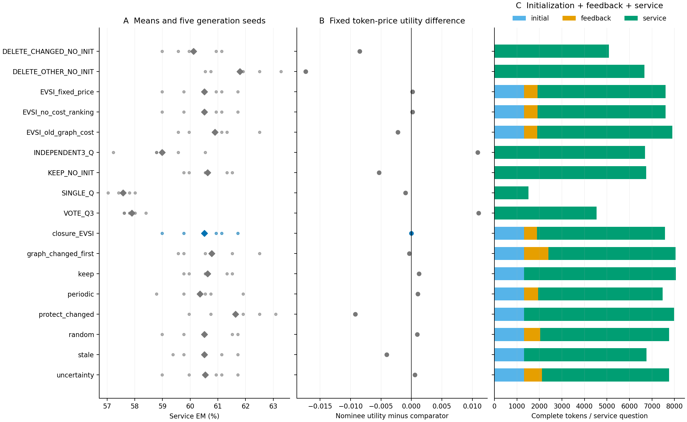

# 第五轮：完整成本下的图条件信用复检

**冻结开发实验结果；不是最终测试或独立确认。**

640 个新 HotpotQA train 问题，八个互斥 I8/C8/S64 episode，五个生成种子。每题九个条件，共 28,800 个终态。512 个不同服务问题；每种方法、每种图变化条件的 2,560 个问题—种子观测不是 2,560 个独立问题。

固定提名 `closure_EVSI`；冻结筛选结论：`STOP_FORMAL5_CANDIDATE`。对照中表现更好的方法不能替补提名。

| 冻结判据 | 结果 |
|---|---|
| independent3_Q_full_token_cost | FAIL |
| independent3_Q_quality | PASS |
| single_Q_quality_and_utility | FAIL |
| utility_over_all_maintenance_and_free_controls | FAIL |
| utility_vs_random_positive_four_of_five_seeds | FAIL |
| vote_Q3_utility | PASS |

## 图改变

| 方法 | EM % | F1 % | 完整 utility | 完整 tokens/服务题 | 平均复检对数 | 初始/复检/服务 tokens 每 episode |
|---|---:|---:|---:|---:|---:|---|
| DELETE_CHANGED_NO_INIT | 60.117 | 70.617 | 0.575727 | 5088.94 | 0.000 | 0.0 / 0.0 / 325692.0 |
| DELETE_OTHER_NO_INIT | 61.797 | 72.744 | 0.584613 | 6671.07 | 0.000 | 0.0 / 0.0 / 426948.3 |
| EVSI_fixed_price | 60.508 | 71.295 | 0.567048 | 7606.07 | 6.300 | 84108.6 / 38973.8 / 363706.2 |
| EVSI_no_cost_ranking | 60.508 | 71.295 | 0.567041 | 7607.40 | 6.350 | 84108.6 / 39058.7 / 363706.2 |
| EVSI_old_graph_cost | 60.898 | 71.592 | 0.569451 | 7906.63 | 6.300 | 84108.6 / 37856.0 / 384059.7 |
| INDEPENDENT3_Q | 58.984 | 70.520 | 0.556352 | 6698.34 | 0.000 | 0.0 / 0.0 / 428693.8 |
| KEEP_NO_INIT | 60.625 | 71.245 | 0.572537 | 6742.51 | 0.000 | 0.0 / 0.0 / 431520.3 |
| SINGLE_Q | 57.578 | 65.539 | 0.568207 | 1514.93 | 0.000 | 0.0 / 0.0 / 96955.4 |
| VOTE_Q3 | 57.891 | 65.895 | 0.556182 | 4544.88 | 0.000 | 0.0 / 0.0 / 290872.5 |
| closure_EVSI | 60.508 | 71.295 | 0.567215 | 7572.58 | 6.350 | 84108.6 / 36830.3 / 363706.2 |
| graph_changed_first | 60.781 | 71.418 | 0.567563 | 8049.98 | 8.000 | 84108.6 / 69761.1 / 361328.8 |
| keep | 60.625 | 71.245 | 0.565966 | 8056.70 | 0.000 | 84108.6 / 0.0 / 431520.3 |
| periodic | 60.352 | 71.100 | 0.566172 | 7468.82 | 8.000 | 84108.6 / 40367.8 / 353528.3 |
| protect_changed | 61.641 | 72.579 | 0.576462 | 7988.82 | 0.000 | 84108.6 / 0.0 / 427176.1 |
| random | 60.508 | 71.266 | 0.566282 | 7759.20 | 8.000 | 84108.6 / 46362.3 / 366117.7 |
| stale | 60.508 | 71.184 | 0.571291 | 6757.50 | 0.000 | 84108.6 / 0.0 / 348371.2 |
| uncertainty | 60.547 | 71.315 | 0.566661 | 7761.61 | 8.000 | 84108.6 / 51341.9 / 361292.2 |

| 对照 | 提名减对照 EM (pp) | utility 点差 | 完整 token 比 | 五种子 utility 点差 |
|---|---:|---:|---:|---|
| DELETE_CHANGED_NO_INIT | 0.391 | -0.008512 | 1.4880 | -0.001586, -0.012013, -0.005972, -0.013149, -0.009840 |
| DELETE_OTHER_NO_INIT | -1.289 | -0.017398 | 1.1351 | -0.026887, -0.021688, -0.011718, -0.015020, -0.011677 |
| EVSI_fixed_price | 0.000 | 0.000167 | 0.9956 | 0.000239, -0.000019, 0.000207, 0.000303, 0.000107 |
| EVSI_no_cost_ranking | 0.000 | 0.000174 | 0.9954 | 0.000239, 0.000000, 0.000207, 0.000317, 0.000107 |
| EVSI_old_graph_cost | -0.391 | -0.002236 | 0.9578 | 0.000239, -0.002940, -0.005728, -0.001889, -0.000864 |
| INDEPENDENT3_Q | 1.523 | 0.010863 | 1.1305 | 0.010333, -0.002029, 0.041171, 0.016377, -0.011536 |
| KEEP_NO_INIT | -0.117 | -0.005322 | 1.1231 | 0.000822, -0.011568, -0.001600, -0.008800, -0.005465 |
| SINGLE_Q | 2.930 | -0.000991 | 4.9986 | 0.000035, -0.016204, 0.009391, 0.004126, -0.002304 |
| VOTE_Q3 | 2.617 | 0.011033 | 1.6662 | 0.019091, -0.003007, 0.018681, 0.017323, 0.003079 |
| closure_EVSI | 0.000 | 0.000000 | 1.0000 | 0.000000, 0.000000, 0.000000, 0.000000, 0.000000 |
| graph_changed_first | -0.273 | -0.000347 | 0.9407 | 0.006552, -0.003874, -0.003589, -0.003917, 0.003091 |
| keep | -0.117 | 0.001249 | 0.9399 | 0.007399, -0.005013, 0.004990, -0.002216, 0.001084 |
| periodic | 0.156 | 0.001044 | 1.0139 | 0.004262, 0.001588, -0.002995, 0.001563, 0.000800 |
| protect_changed | -1.133 | -0.009247 | 0.9479 | -0.018312, -0.015133, -0.005128, -0.008436, 0.000775 |
| random | 0.000 | 0.000933 | 0.9759 | 0.005428, 0.001216, -0.000022, -0.002798, 0.000841 |
| stale | 0.000 | -0.004075 | 1.1206 | 0.001107, -0.008422, -0.003220, -0.007498, -0.002344 |
| uncertainty | -0.039 | 0.000555 | 0.9756 | 0.000483, 0.001383, 0.000618, 0.001142, -0.000853 |

## 无图改变对照

| 方法 | EM % | F1 % | 完整 utility | 完整 tokens/服务题 | 平均复检对数 | 初始/复检/服务 tokens 每 episode |
|---|---:|---:|---:|---:|---:|---|
| DELETE_CHANGED_NO_INIT | 60.742 | 71.718 | 0.573606 | 6763.10 | 0.000 | 0.0 / 0.0 / 432838.1 |
| DELETE_OTHER_NO_INIT | 60.312 | 71.543 | 0.569307 | 6763.57 | 0.000 | 0.0 / 0.0 / 432868.5 |
| EVSI_fixed_price | 60.430 | 71.646 | 0.560791 | 8701.08 | 6.525 | 84108.6 / 39827.5 / 432933.1 |
| EVSI_no_cost_ranking | 60.391 | 71.644 | 0.560400 | 8701.16 | 6.525 | 84108.6 / 39826.5 / 432939.3 |
| EVSI_old_graph_cost | 60.430 | 71.646 | 0.560881 | 8683.25 | 6.525 | 84108.6 / 38686.3 / 432933.1 |
| INDEPENDENT3_Q | 58.984 | 70.520 | 0.556352 | 6698.34 | 0.000 | 0.0 / 0.0 / 428693.8 |
| KEEP_NO_INIT | 59.766 | 70.968 | 0.563482 | 6834.75 | 0.000 | 0.0 / 0.0 / 437424.0 |
| SINGLE_Q | 57.578 | 65.539 | 0.568207 | 1514.93 | 0.000 | 0.0 / 0.0 / 96955.4 |
| VOTE_Q3 | 57.891 | 65.895 | 0.556182 | 4544.88 | 0.000 | 0.0 / 0.0 / 290872.5 |
| closure_EVSI | 60.430 | 71.646 | 0.560881 | 8683.25 | 6.525 | 84108.6 / 38686.3 / 432933.1 |
| graph_changed_first | 60.547 | 71.773 | 0.561855 | 8722.67 | 8.000 | 84108.6 / 41313.0 / 432829.3 |
| keep | 59.766 | 70.968 | 0.556912 | 8148.95 | 0.000 | 84108.6 / 0.0 / 437424.0 |
| periodic | 60.508 | 71.763 | 0.561496 | 8716.38 | 8.000 | 84108.6 / 40798.2 / 432941.6 |
| protect_changed | 60.430 | 71.646 | 0.563911 | 8077.16 | 0.000 | 84108.6 / 0.0 / 432829.8 |
| random | 60.508 | 71.732 | 0.561029 | 8809.79 | 8.000 | 84108.6 / 46891.4 / 432826.3 |
| stale | 60.430 | 71.646 | 0.563911 | 8077.16 | 0.000 | 84108.6 / 0.0 / 432829.8 |
| uncertainty | 60.469 | 71.685 | 0.560359 | 8865.63 | 8.000 | 84108.6 / 50458.1 / 432833.7 |

| 对照 | 提名减对照 EM (pp) | utility 点差 | 完整 token 比 | 五种子 utility 点差 |
|---|---:|---:|---:|---|
| DELETE_CHANGED_NO_INIT | -0.313 | -0.012726 | 1.2839 | -0.014888, -0.014867, -0.017323, -0.009472, -0.007080 |
| DELETE_OTHER_NO_INIT | 0.117 | -0.008427 | 1.2838 | -0.005126, -0.007058, -0.001693, -0.023136, -0.005120 |
| EVSI_fixed_price | 0.000 | 0.000089 | 0.9980 | 0.000000, 0.000000, 0.000125, 0.000320, 0.000000 |
| EVSI_no_cost_ranking | 0.039 | 0.000480 | 0.9979 | 0.000000, 0.001955, 0.000125, 0.000320, 0.000000 |
| EVSI_old_graph_cost | 0.000 | 0.000000 | 1.0000 | 0.000000, 0.000000, 0.000000, 0.000000, 0.000000 |
| INDEPENDENT3_Q | 1.445 | 0.004529 | 1.2963 | 0.021886, -0.011281, 0.019482, -0.001976, -0.005468 |
| KEEP_NO_INIT | 0.664 | -0.002602 | 1.2705 | 0.008908, 0.008922, 0.000614, -0.020831, -0.010622 |
| SINGLE_Q | 2.852 | -0.007326 | 5.7318 | 0.011587, -0.025456, -0.012298, -0.014227, 0.003764 |
| VOTE_Q3 | 2.539 | 0.004699 | 1.9106 | 0.030644, -0.012259, -0.003008, -0.001030, 0.009147 |
| closure_EVSI | 0.000 | 0.000000 | 1.0000 | 0.000000, 0.000000, 0.000000, 0.000000, 0.000000 |
| graph_changed_first | -0.117 | -0.000975 | 0.9955 | -0.001187, -0.003125, -0.001640, 0.000342, 0.000736 |
| keep | 0.664 | 0.003969 | 1.0656 | 0.015485, 0.015477, 0.007204, -0.014247, -0.004073 |
| periodic | -0.078 | -0.000616 | 0.9962 | -0.001227, -0.003161, 0.000317, 0.000295, 0.000698 |
| protect_changed | 0.000 | -0.003030 | 1.0750 | -0.002458, -0.002459, -0.004870, -0.002884, -0.002482 |
| random | -0.078 | -0.000149 | 0.9856 | -0.000043, 0.003256, -0.001640, -0.003052, 0.000736 |
| stale | 0.000 | -0.003030 | 1.0750 | -0.002458, -0.002459, -0.004870, -0.002884, -0.002482 |
| uncertainty | -0.039 | 0.000521 | 0.9794 | -0.000144, 0.001402, -0.001110, 0.000596, 0.001863 |

## 成本、反馈与公平性

正式采集实际 GPU 驻留 25.21026332 小时；资格验证另计 0.0661232537121719 小时，不能重复加账。驻留包含模型加载和等待，不等同 GPU kernel 时间。
主效用为服务 EM − (0.005/1000) × (初始化+复检+服务 tokens)/64。该权重是预先声明的研究折衷，不是货币价格。各方法共享每 episode 3,000,000 token 上限，但实际花费不同；不把同一上限写成相同实际花费。剩余额度、分模型 kernel、调用、token 与 Gold 观测数保留在 CSV/JSON。
完整测量网格使用物理缓存以减少实验开销；策略只在购买后读取相应 C 反馈，只减免已经付费的精确请求。服务成本重新全额计入选定图的全部活跃节点。所有方法共享精确死节点省略，不能将其收益归为复检策略优势。
静态免初始化对照不收取初始化反馈费用；维护方法包括 keep 均收取初始化。反馈来自 benchmark gold 理想 oracle；人工标注、金融价格、能耗、代理推理等未测量，不能声称现实总经济成本优势。

## 决策错误与恢复的解释

`METHOD_POINTS.csv` 提供相对 keep/stale 的纠错、破坏，以及旧信用建议删除但最终选择 keep 的 episode—seed 数。后者只是终态决策反转代理，不是已经部署删除后成功恢复边的在线轨迹。报告没有证明恢复机制。
删除造成错误的计数使用相同问题与种子的 keep 结果作反事实对照；它不等于已知真实期望信用符号。跨种子共享题目，episode 是一次构造的有限随机划分，不能用种子数量冒充跨任务重复。

## 证据与局限

优势：同预测器、同 I/C/S、同模型、固定方法与门槛、完整实际逻辑成本，以及无标签收集后 CPU 请求回放和第二实现算术审计。风险：一个任务、两个模型、两条可编辑边、一次受控图变化、小样本初始化、简单可分离先验、benchmark 标签 oracle，以及缓存回放而非实时部署。
主判据是开发筛选，不是显著性检验、非劣保证或外部泛化结论。没有计算置信区间或执行 bootstrap。审计为研究代理的第二实现，不是人类独立审稿或真实新种子模型再生成。
所有图的额外分组、固定 H=64 策略的服务前缀曲线和四个 token 权重敏感性均为描述结果，不用于改变主权重、服务期限或重选候选。前缀曲线不能解释为每个较短期限下重新最优化的策略。官方 validation/test 保持未打开；本轮数据评分后属于已曝光开发数据。

每个小点是一个生成种子；没有误差条。完整成本包含 I/C/S。图表和报告从冻结汇总与已审计私有重放生成，不含题目、答案、逐题矩阵或凭据。
