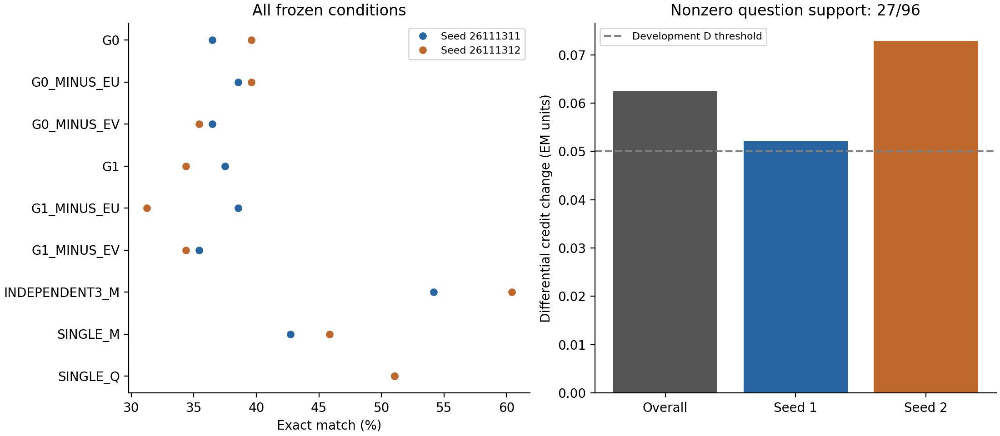

# 第三轮：外生替代路径的信用变化机制筛选

**开发机制筛选，不是有效方法确认。** 固定 96 个新 HotpotQA train 题、两个生成种子、9 个条件，全部 1,728 个终态纳入。官方 validation/test 未打开。

预定主对比 D=0.06250000；两个种子分别为 0.05208333、0.07291667；非零题均对比支持 27/96。

冻结筛选结论：`RETAIN_MECHANISM_FOR_NEW_CONTRACT_REVIEW`。判据为 D≥0.05、两种子 D 都为正、非零题均支持至少 20；不以 F1 或分组结果替代。它是经验开发过滤，不表示显著性或总体保证，也不自动批准新 GPU 实验。

## 实际准确率

| 条件 | Seed 26111311 | Seed 26111312 | 两种子均值 |
|---|---:|---:|---:|
| G0 | 36.458% | 39.583% | 38.021% |
| G0_MINUS_EU | 38.542% | 39.583% | 39.062% |
| G0_MINUS_EV | 36.458% | 35.417% | 35.938% |
| G1 | 37.500% | 34.375% | 35.938% |
| G1_MINUS_EU | 38.542% | 31.250% | 34.896% |
| G1_MINUS_EV | 35.417% | 34.375% | 34.896% |
| INDEPENDENT3_M | 54.167% | 60.417% | 57.292% |
| SINGLE_M | 42.708% | 45.833% | 44.271% |
| SINGLE_Q | 51.042% | 51.042% | 51.042% |

## 配对点差、纠错与破坏

| 比较 | 种子 | 点差 pp | 纠错 | 破坏 | 题数 |
|---|---:|---:|---:|---:|---:|
| G0_minus_INDEPENDENT3_M | 26111311 | -17.708 | 8 | 25 | 96 |
| G0_minus_INDEPENDENT3_M | 26111312 | -20.833 | 5 | 25 | 96 |
| G0_minus_SINGLE_M | 26111311 | -6.250 | 7 | 13 | 96 |
| G0_minus_SINGLE_M | 26111312 | -6.250 | 10 | 16 | 96 |
| G0_minus_SINGLE_Q | 26111311 | -14.583 | 11 | 25 | 96 |
| G0_minus_SINGLE_Q | 26111312 | -11.458 | 8 | 19 | 96 |
| G1_minus_INDEPENDENT3_M | 26111311 | -16.667 | 10 | 26 | 96 |
| G1_minus_INDEPENDENT3_M | 26111312 | -26.042 | 6 | 31 | 96 |
| G1_minus_SINGLE_M | 26111311 | -5.208 | 10 | 15 | 96 |
| G1_minus_SINGLE_M | 26111312 | -11.458 | 9 | 20 | 96 |
| G1_minus_SINGLE_Q | 26111311 | -13.542 | 9 | 22 | 96 |
| G1_minus_SINGLE_Q | 26111312 | -16.667 | 9 | 25 | 96 |

## 完整成本与失败

实际正式 GPU 驻留 1.56944372 小时；含全部资格验证 1.68640831 小时。物理生成 3072 次，完整逻辑调用 5,760 次。正式原生失败 0 次、未知后台请求 0 次。

先前资格验证的过长人工样例失败已原样保留并计入费用；另有一次显存放置检查在启动子进程前拒绝，GPU 费用为零。实际模型内核时间、完整逻辑 token/调用与进程驻留分别记录，不能互相替代。金钱费用和人工标签费用未测，记 null。

## 证据边界

文档分片与单条中继路径删除是人为控制机制；没有声称真实部署必须分散信息。D 衡量两条边信用变化之差，不等于受影响边绝对信用一定增加。共同随机数用于图间配对，两种子不是两个独立数据集。

当前 96 题在评分后属于已曝光开发数据，不得重新作为独立确认。没有运行在线信用维护策略、预算化主动采集或未来服务实验，因此不宣称它们优于随机复检、免费结构保护或中央条件路由。

本轮不计算置信区间、不执行 bootstrap。独立核对是独立标准库算术实现，不是独立人类审稿或独立模型再生成。候选/实例结论不等于项目停止。

图为实际点估计；每个点对应一个生成种子，没有误差条。汇总 JSON 同时保留 F1、两条边的旧/新信用、分模型完整逻辑成本与物理成本。
